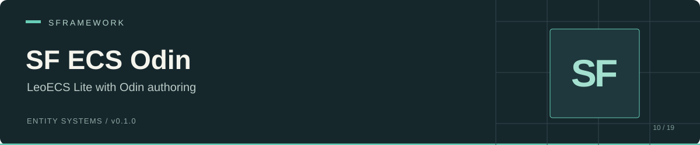

# SF ECS Odin

Configured **LeoECS Lite** worlds, Unity entity authoring, and system lifecycle integration for SFramework, with Odin Inspector attributes.

 

[Install](#installation) · [Setup](#bootstrap-and-world-configuration) · [Authoring](#component-authoring) · [Systems](#systems-and-phase-order) · [API](#public-api) · [Limits](#known-limits)

## Installation

Add this URL through Unity Package Manager's **Add package from git URL**:

```text
https://github.com/huran438/sf-ecs-odin.git#main
```

The package ID is `sp.sframework.ecs.odin`, version `0.1.0`. [package.json](package.json) contains no dependency entries or minimum Unity version.

| Required assembly / asset | Use |
| --- | --- |
| `SFramework.Core.Runtime`, `SFramework.Core.Editor` | [SF Core](https://github.com/huran438/sf-core); container, view injection, and editor tools. |
| `SFramework.Configs.Runtime` | [SF Configs](https://github.com/huran438/sf-configs); world configuration and ID selection. |
| `Leopotam.EcsLite`, `Leopotam.EcsLite.Di` | Compatible LeoECS Lite and its DI integration. |
| `UniTask` | Service initialization. |
| Odin Inspector / Serializer | A separately licensed installation supplying the referenced Sirenix DLLs. This package does not bundle Odin. |

The [runtime asmdef](Runtime/SFramework.ECS.Runtime.asmdef) references Odin attributes, serialization, utilities, and serialization config DLLs. The [editor asmdef](Editor/SFramework.ECS.Editor.asmdef) also references Odin editor and utilities editor DLLs.

Choose this package or [SF ECS](https://github.com/huran438/sf-ecs), since both declare `SFramework.ECS.Runtime` / `SFramework.ECS.Editor` and overlapping types. [SF ECS Proto](https://github.com/huran438/sf-ecs-proto) uses a different ECS backend.

The checked Core and Configs branches expose the lifecycle APIs this variant calls. That is a source-level match, not a Unity compatibility test. Review the world-selector and entity-recreation limitations below before integration.

## Bootstrap and world configuration

Register Configs before Worlds: the worlds-service constructor requires `ISFConfigsService`. Core initializes registered services in order, so Configs must load before Worlds reads `SFWorldsConfig`.

Keep the entity group inactive in the scene until service initialization completes. Otherwise an entity's `SFView.Awake` can cache the fallback world before the service creates the configured world.

Save this root as `EcsContext.cs`, assign an inactive entity group, and place the root outside that group:

```csharp
using System.Threading;
using Cysharp.Threading.Tasks;
using SFramework.Configs.Runtime;
using SFramework.Core.Runtime;
using SFramework.ECS.Runtime;
using UnityEngine;

public sealed class EcsContext : SFContextRoot
{
    [SerializeField] private GameObject _entityGroup;

    protected override void PreInit()
    {
    }

    protected override void Bind()
    {
        SFContainer.Register<ISFConfigsService, SFConfigsService>();
        SFContainer.Register<ISFWorldsService, SFWorldsService>();
    }

    protected override UniTask Init(CancellationToken cancellationToken)
    {
        _entityGroup.SetActive(true);
        return UniTask.CompletedTask;
    }
}
```

With the checked SF Configs loader, place this configuration in `Assets/Resources/SFWorldsConfig.json`. It defines one named world and empty phase lists:

```json
{
  "Type": "SFWorldsConfig",
  "Id": "ECS",
  "Version": 1,
  "Worlds": [
    {
      "Id": "Gameplay",
      "Config": {},
      "FixedUpdateSystems": [],
      "UpdateSystems": [],
      "LateUpdateSystems": []
    }
  ]
}
```

`SFWorldConfig` defaults to 512 for entity, recycled-entity, pool, filter, dense-pool, and recycled-pool capacities; `EntityComponentsSize` defaults to 8. `SFWorldsService` forwards those fields to `EcsWorld.Config`. Keep `Config` and each phase array non-null.

The service indexes named worlds by `SFWorldNode.Id`, such as `Gameplay`. An empty or unknown name returns its separate fallback world. `Worlds` excludes that fallback; the fallback has no configured systems.

**World selector caveat:** the checked SF Configs drawer writes full paths such as `ECS/Gameplay`, while this service looks up `Gameplay`. Verify the serialized entity world string and the result of `GetWorld`. A full-path dropdown value can route the entity into the fallback world. Use the required short ID through your project tooling until the selector/lookup contract agrees.

## Component authoring

Save the struct below as `Health.cs` in your project. The editor generator scans `[SFGenerateComponent]` structs and writes `_Health.cs` beside that file, in the same namespace.

```csharp
using System;
using SFramework.ECS.Runtime;
using UnityEngine;

namespace Example.Ecs
{
    [Serializable]
    [SFGenerateComponent]
    public struct Health : ISFComponent, IEcsAutoInit<Health>
    {
        public int Current;

        public void AutoInit(ref Health component)
        {
            component.Current = Mathf.Max(1, component.Current);
        }
    }
}
```

Add `_Health` from the `SFComponents` menu. Its generated `RequireComponent` attribute adds `SFEntity`. Configure the entity's world before enabling the entity group.

`SFComponent<T>.Setup` caches the world/pool and packed handle, runs auto-initialization, and adds a copy of `_value` to the pool. This variant exposes a protected authoring field rather than a public `Value` property. Edit the live pool for changes after creation.

Use **Edit → SFramework → Regenerate ECS Components** to force regeneration; editor-load generation skips existing files. The source file must match `<TypeName>.cs`. An unresolved source path logs a warning and skips that type. `SFGenerateComponentAttribute(Type customBaseType)` supports a custom provider base.

Providers can dispatch `ISFDrawGizmos<T>` and `ISFDrawGizmosSelected<T>` from live pool data. They need a valid entity and component first, so they do not draw from the serialized value before entity creation.

## Entity lifecycle


`SFView` injects the entity and calls `Init()`, which discovers providers and caches the selected world and reference pools. `OnEnable()` then calls `CreateEntity()`. Creation adds `GameObjectRef`, `TransformRef`, and `RootEntity` when the cached hierarchy check marks the GameObject as a root. `OnValidate()` determines that flag from ancestor `SFEntity` components.

`removeEntityOnDisable` defaults to false. In that mode, disabling the GameObject retains its entity and mapping; ECS systems can still encounter it. Set the flag to true to delete on disable and create a new entity on re-enable. `OnDestroy()` deletes a created entity.

Treat `EcsPackedEntity` as a handle that can expire. This variant returns it by reference. Avoid overwriting it: lifecycle methods depend on that stored value.

## Systems and phase order

Each configured world owns separate `EcsSystems` lists for fixed, regular, and late updates. The service constructs enabled `IEcsSystem` types in array order with `Activator.CreateInstance`, then calls `.Inject().Init()` on each list. `SFECSCallbacks` forwards Unity's three update phases to `Run()`.

Use concrete systems with parameterless constructors. Store `typeof(YourSystem).AssemblyQualifiedName` in `SFSystemContainer.System`; unresolved names and non-system types get skipped. Putting the same type in two phases creates two instances. Duplicate world IDs get skipped.

`SFSystem.PreInit` performs SF Core injection. Its run hook uses the Lite signature:

```csharp
using Leopotam.EcsLite;
using SFramework.ECS.Runtime;

namespace Example.Ecs
{
    public sealed class CountTicksSystem : SFSystem
    {
        public int TickCount { get; private set; }

        protected override void Tick(ref IEcsSystems systems)
        {
            TickCount++;
        }
    }
}
```

Add a configuration entry with `Enabled = true` and `System = typeof(CountTicksSystem).AssemblyQualifiedName` to the desired phase. There is no system-name picker on the `System` string field in this package.

For pipelines you build yourself, `SFExtensions.Add(ISFSystem[])` accepts individual Lite systems and one level of `ISFSystemsGroup`. It does not recurse into nested groups. The configured worlds service instantiates `IEcsSystem` entries directly and does not use this group-expansion helper.

## Public API

| API | Behavior |
| --- | --- |
| [`ISFWorldsService`](Runtime/ISFWorldsService.cs) | `GetWorld(string name = "")` and configured `Worlds`. |
| [`SFWorldsService`](Runtime/SFWorldsService.cs) | `Init(CancellationToken)`, phase callbacks, and `Dispose()`. |
| [`SFEntity`](Runtime/SFEntity.cs) | Ref-return packed handle, `CreateEntity()`, `DestroyEntity()`, `RecreateEntity()`, and `removeEntityOnDisable`. See recreation limit below. |
| [`SFComponent<T>`](Runtime/SFComponent.cs) | Serialized authoring, auto-init, and live gizmo hooks. |
| [`SFSystem`](Runtime/SFSystem.cs) | SF injection in `PreInit` and `Tick(ref IEcsSystems)`. |
| [`SFSystemsGroupBase`](Runtime/SFSystemsGroupBase.cs) | Abstract `Systems` array and implicit array conversion. |
| [`SFEntityMapping`](Runtime/SFEntityMapping.cs) | World/entity and packed lookups, null checks, and `Clear()`. |
| [`SFExtensions`](Runtime/SFExtensions.cs) | Pool `Replace`, system-array `Add`, and GameObject lookup extensions. |
| [`SFSerializableType`](Runtime/SFSerializableType.cs) | Serialized type names and filtered drawer support; separate from the system string field. |

`Replace<T>` returns existing pool data or adds a component. `TryGetEntityPacked` confirms a mapping entry; call `Unpack` to confirm a live entity. `Clear()` removes mappings without deleting entities.

## Known limits

- `DestroyEntity()` does not reset `_createdEntity`. As a result, `RecreateEntity()` deletes a created entity, then `CreateEntity()` returns because the flag remains true. Calling `DestroyEntity()` followed by `CreateEntity()` has the same problem. The disable path resets the flag when `removeEntityOnDisable` is true.
- `Dispose()` clears lists and unsubscribes callbacks. It does not destroy `EcsSystems`, worlds, or the persistent callback GameObject. Define host ownership and cleanup before repeated bootstraps.
- Repeated `Init()` calls can subscribe the same callbacks again. Initialize each service instance once.
- The world selector and lookup use different ID shapes with the checked Configs drawer, as described above.
- Serialized type names need updates after assembly/type renames. `SFSerializableType` can keep a non-empty unresolved name with a null `Type`; its drawer assumes at least one candidate.

## Validation, related packages, and license

This README describes source at commit [`e24b463`](https://github.com/huran438/sf-ecs-odin/commit/e24b4635c7bf2d13a395ed9a54224e0cfe21a4eb). The examples received static source review only. No Unity compilation, Play Mode, player build, or automated test execution accompanied this documentation. The package declares no minimum Unity version.

[SF Core](https://github.com/huran438/sf-core) and [SF Configs](https://github.com/huran438/sf-configs) provide the supporting lifecycle/configuration. [SF ECS Tween](https://github.com/huran438/sf-ecs-tween) supplies Lite tween data and interpolation helpers. [SF ECS Proto](https://github.com/huran438/sf-ecs-proto) uses Proto rather than Lite.

This repository uses the [MIT license](LICENSE.md). Odin and other dependencies retain their own licensing terms.
