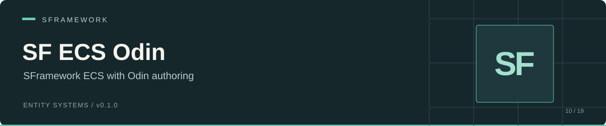
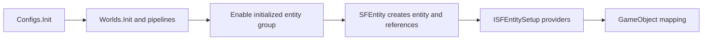

# SF ECS Odin

 

## Overview

Self-contained ECS worlds, Unity entity authoring, and system lifecycle integration for SFramework, with Odin Inspector attributes. The ECS runtime is embedded in `SFramework.ECS.Runtime` and dependency injection uses SF Core.

## Requirements

The package ID is `sp.sframework.ecs.odin`, version `0.1.0`. [package.json](package.json) contains no dependency entries or minimum Unity version.

| Required assembly / asset | Use |
| --- | --- |
| `SFramework.Core.Runtime`, `SFramework.Core.Editor` | [SF Core](https://github.com/huran438/sf-core); container, view injection, and editor tools. |
| `SFramework.Configs.Runtime` | [SF Configs](https://github.com/huran438/sf-configs); world configuration and ID selection. |
| `UniTask` | Service initialization. |
| Odin Inspector / Serializer | A separately licensed installation supplying the referenced Sirenix DLLs. This package does not bundle Odin. |

The [runtime asmdef](Runtime/SFramework.ECS.Runtime.asmdef) references Odin attributes, serialization, utilities, and serialization config DLLs. The [editor asmdef](Editor/SFramework.ECS.Editor.asmdef) also references Odin editor and utilities editor DLLs.

Choose this package or [SF ECS](https://github.com/huran438/sf-ecs), since both declare `SFramework.ECS.Runtime` / `SFramework.ECS.Editor` and overlapping types. [SF ECS Proto](https://github.com/huran438/sf-ecs-proto) uses a different ECS backend.

Install the transitive dependencies of SF Core and SF Configs too: SF Debug, UniTask, and Newtonsoft.Json. The required Sirenix DLLs must be present. Generated providers use ordinary Unity attributes. Regenerate older providers that still include the `IL2CPP_OPTIMIZATIONS` block before using that define in a player build.

`SFEcsWorld`, `SFEcsPool<T>`, `SFEcsFilter`, packed entities, and system interfaces are included in `SFramework.ECS.Runtime`. The kernel supports IL2CPP and the `SFECS_FILTER_EVENTS`, `SFECS_WORLD_EVENTS`, and `SFECS_NO_SANITIZE_CHECKS` scripting defines.

### Migrating existing systems

Use `SFramework.ECS.Runtime` in consumers and remove obsolete external ECS assembly references and package dependencies when unused. ECS types use the `SFEcs` prefix. Migrate serialized type names to the SFramework assembly and namespace.

The runtime sources live directly in `Runtime`, alongside the authoring integration:

| Previous type | Current type |
| --- | --- |
| `EcsWorld` | `SFEcsWorld` |
| `EcsPool<T>` | `SFEcsPool<T>` |
| `EcsFilter` | `SFEcsFilter` |
| `EcsSystems` / `IEcsSystems` | `SFEcsSystems` / `ISFEcsSystems` |
| `EcsPackedEntity` / `EcsPackedEntityWithWorld` | `SFEcsPackedEntity` / `SFEcsPackedEntityWithWorld` |
| `IEcsRunSystem`, `IEcsInitSystem`, other `IEcs*` contracts | `ISFEcsRunSystem`, `ISFEcsInitSystem`, other `ISFEcs*` contracts |

The existing `ISFSystem` authoring marker and `SFEntity.EcsPackedEntity` property keep their names. `.editorconfig` defines the package's C# formatting conventions.

Use automatic mutable service fields on a partial `ISFInjectable` system (or derive from `SFSystem`). Inject `ISFEcsContext` for pipeline-scoped worlds, pools, filters, and shared data. See [ECS dependency injection](#ecs-dependency-injection) for setup.

`SFEcsSystems.Init()` injects all `ISFInjectable` systems through `SFContainer` before any `PreInit` or `Init` callback, including manually built pipelines. Register services before calling `Init`; a separate `.Inject()` call is no longer needed. Each system receives injection once per pipeline initialization, and existing lifecycle callbacks keep their order. SFInject was removed; migrate properties/methods to fields and lifecycle hooks.

## Installation

Add this URL through Unity Package Manager's **Add package from git URL**:

```text
https://github.com/huran438/sf-ecs-odin.git#main
```

## Quick start

### Bootstrap and world configuration

Register Configs before Worlds: the worlds-service constructor requires `ISFConfigsService`. Core initializes registered services in order, so Configs must load before Worlds reads `SFWorldsConfig`.

Named `SFEntity` views enabled before world initialization wait for their configured worlds. You can keep an entity group inactive until the context finishes initializing when its setup also depends on other services.

Save this root as `EcsContext.cs`, assign an inactive entity group, and place the root outside that group:

```csharp
using System.Threading;
using Cysharp.Threading.Tasks;
using SFramework.Configs.Runtime;
using SFramework.Core.Runtime;
using SFramework.ECS.Runtime;
using UnityEngine;

public sealed class EcsContext : SFContextRoot
{
    [SerializeField] private GameObject _entityGroup;

    protected override void PreInit()
    {
    }

    protected override void Bind()
    {
        SFContainer.Register<ISFConfigsService, SFConfigsService>();
        SFContainer.Register<ISFWorldsService, SFWorldsService>();
    }

    protected override UniTask Init(CancellationToken cancellationToken)
    {
        _entityGroup.SetActive(true);
        return UniTask.CompletedTask;
    }
}
```

With SF Configs, place this configuration in `Assets/Resources/SFWorldsConfig.json`. It defines one named world and empty phase lists:

```json
{
  "Type": "SFWorldsConfig",
  "Id": "ECS",
  "Version": 1,
  "Worlds": [
    {
      "Id": "Gameplay",
      "Config": {},
      "FixedUpdateSystems": [],
      "UpdateSystems": [],
      "LateUpdateSystems": []
    }
  ]
}
```

`SFWorldConfig` defaults to 512 for entity, recycled-entity, pool, filter, dense-pool, and recycled-pool capacities. `EntityComponentsSize` defaults to 8. Missing `Config` uses these defaults, and missing phase arrays have no systems.

The service looks up the same full IDs as the SF Configs drawer, such as `ECS/Gameplay`. A short ID such as `Gameplay` remains valid when it identifies one configured world. Empty, unknown, and ambiguous names return the fallback world. `Worlds` lists the configured worlds. The fallback has no configured systems.

### Component authoring

Save the struct below as `Health.cs` in your project. The editor generator scans `[SFGenerateComponent]` structs and writes `_Health.cs` beside that file, in the same namespace.

```csharp
using System;
using SFramework.ECS.Runtime;
using UnityEngine;

namespace Example.Ecs
{
    [Serializable]
    [SFGenerateComponent]
    public struct Health : ISFComponent, ISFEcsAutoInit<Health>
    {
        public int Current;

        public void AutoInit(ref Health component)
        {
            component.Current = Mathf.Max(1, component.Current);
        }
    }
}
```

Add `_Health` from the `SFComponents` menu. Its generated `RequireComponent` attribute adds `SFEntity`. Configure the entity's world before enabling the entity group.

`SFComponent<T>.Setup` caches the world/pool and packed handle, runs auto-initialization, and adds a copy of `_value` to the pool. This variant exposes a protected authoring field rather than a public `Value` property. Edit the live pool for changes after creation.

Use **Edit → SFramework → Regenerate ECS Components** to force regeneration. Editor-load generation skips existing files. The source file must match `<TypeName>.cs`. The generator identifies the script by type when possible and uses the containing assembly to resolve remaining candidates. It reports ambiguous or unavailable files and skips generation for those types. `SFGenerateComponentAttribute(Type customBaseType)` supports an inheritable `MonoBehaviour` provider base.

Providers can dispatch `ISFDrawGizmos<T>` and `ISFDrawGizmosSelected<T>` from live pool data. They need a valid entity and component first, so they do not draw from the serialized value before entity creation.

### Entity lifecycle



`SFView` injects the entity and calls `Init()`, which discovers providers. `OnEnable()` creates the entity once the selected world is available. Creation looks up the world, registers the GameObject mapping, and adds `GameObjectRef`, `TransformRef`, and `RootEntity` when the hierarchy check marks the GameObject as a root. `OnValidate()` determines that flag from ancestor `SFEntity` components. If provider setup throws, creation deletes the entity and removes its mapping so callers can retry.

`removeEntityOnDisable` defaults to false. In that mode, disabling the GameObject retains its entity and mapping; ECS systems can still encounter it. Set the flag to true to delete on disable and create a new entity on re-enable. `OnDestroy()` deletes a created entity.

Treat `SFEcsPackedEntity` as a handle that can expire. This variant returns it by reference. Avoid overwriting it: lifecycle methods depend on that stored value.

### Systems and phase order

Each configured world owns separate `SFEcsSystems` lists for fixed, regular, and late updates. The service constructs enabled `ISFEcsSystem` types in array order with `Activator.CreateInstance`, then calls `Init()` on each list. `SFEcsSystems.Init()` performs SF Core injection before lifecycle callbacks. `SFECSCallbacks` forwards Unity's three update phases to `Run()`.

Use concrete systems with public parameterless constructors. Store `typeof(YourSystem).AssemblyQualifiedName` in `SFSystemContainer.System`. Invalid entries log a warning that names the world and phase. Putting the same type in two phases creates two instances. Duplicate full world IDs get skipped.

`SFSystem` implements `ISFInjectable` and receives SF Core injection from its pipeline. Its run hook keeps the existing signature:

```csharp
using SFramework.ECS.Runtime;

namespace Example.Ecs
{
    public sealed class CountTicksSystem : SFSystem
    {
        public int TickCount { get; private set; }

        protected override void Tick(ref ISFEcsSystems systems)
        {
            TickCount++;
        }
    }
}
```

Add a configuration entry with `Enabled = true` and `System = typeof(CountTicksSystem).AssemblyQualifiedName` to the desired phase. There is no system-name picker on the `System` string field in this package.

For pipelines you build yourself, `SFExtensions.Add(ISFSystem[])` accepts individual Lite systems and one level of `ISFSystemsGroup`. It does not recurse into nested groups. The configured worlds service instantiates `ISFEcsSystem` entries directly and does not use this group-expansion helper.

### ECS dependency injection

Declare a mutable `ISFEcsContext` field on a partial system. SF Core fills the field alongside ordinary service dependencies. Cache the pools and filters you need in `ISFInjectionCallback.OnDependenciesInjected()` or in `Init()`.

```csharp
public sealed partial class MoveSystem : SFSystem, ISFInjectionCallback
{
    private ISFEcsContext _ecs;
    private SFEcsPool<Position> _positions;
    private SFEcsFilter _moving;

    public void OnDependenciesInjected()
    {
        _positions = _ecs.GetPool<Position>();
        _moving = _ecs.Filter<Position>().Inc<Velocity>().End();
    }
}
```

Use `GetWorld(name)`, `GetPool<T>(name)`, and `Filter<T>(name)` for named worlds. Register names with `AddWorld()` on standalone pipelines. Configured pipelines expose all configured worlds under their full IDs, such as `Gameplay/Events`. An omitted name selects the pipeline's own world. Unknown names throw. `GetShared<T>()` returns the optional shared object passed to `new SFEcsSystems(world, shared)`. Register custom application dependencies through SF Core and inject them in separate fields.

### Switchable groups and event cleanup

```csharp
var pipeline = new SFEcsSystems(world);
pipeline.AddWorld(events, "events")
    .AddGroup("Movement", true, "events", new MoveSystem())
    .DelHere<MovementEvent>("events");
pipeline.Init();
```

`DelHere<T>()` removes that component at its position in the run phase and preserves other components on the same entity. Use a unique group name within each event world. To switch a group, add an `SFEcsGroupSystemState` component to an entity in that world and set its `Name` and `State`. The group consumes matching events before its run and post-run callbacks. Disabled groups still initialize and shut down their children. Nested children receive SF Core injection before any system begins PreInit. For a configured pipeline, use concrete subclasses of `SFEcsGroupSystem` or `SFEcsDelHereSystem<T>` with public parameterless constructors.

### ECS Monitor

In Unity Play Mode, open **Window → SFramework → ECS Monitor**. Select a world and search by entity ID or component type. The window refreshes entity IDs, generations, and component values while the game runs. It also sees standalone worlds created in the editor.

Use **Add component** to search for `ISFComponent` types, types marked with `SFGenerateComponent`, and component types already registered in that world. Use **Remove** on a component's header. Removing the last component also removes the entity.

Edit public and explicitly exposed fields in place. Numeric values, enums, common Unity value types, and Unity object references use typed controls. Nested value-type fields can be edited. Read-only fields and the contents of managed objects and collections are shown as previews. Each edit is merged into the latest component value.

### ECS Systems Profiler

In Unity Play Mode, open **Window → SFramework → ECS Systems Profiler**. Select a world and phase to see the configured system order and nested groups. Standalone pipelines appear under **Manual**.

The **Run** and **PostRun** columns show the last, average, and peak callback time in milliseconds and the invocation count. Group timings include their children and state checks. A disabled group can still check for state changes, while its disabled descendants stop receiving callbacks. Use **Record** to pause or resume collection and **Clear** to reset the measurements. Closing the window or leaving Play Mode ends the recording.

## API

| API | Behavior |
| --- | --- |
| [`ISFWorldsService`](Runtime/ISFWorldsService.cs) | `GetWorld(string name = "")` and configured `Worlds`. |
| [`SFWorldsService`](Runtime/SFWorldsService.cs) | `Init(CancellationToken)`, phase callbacks, and `Dispose()`. |
| [`SFEntity`](Runtime/SFEntity.cs) | Ref-return packed handle, `CreateEntity()`, `DestroyEntity()`, `RecreateEntity()`, and `removeEntityOnDisable`. |
| [`SFComponent<T>`](Runtime/SFComponent.cs) | Serialized authoring, auto-init, and live gizmo hooks. |
| [`SFSystem`](Runtime/SFSystem.cs) | SF Core injection by `SFEcsSystems.Init()` and `Tick(ref ISFEcsSystems)`. |
| [`SFSystemsGroupBase`](Runtime/SFSystemsGroupBase.cs) | Abstract `Systems` array and implicit array conversion. |
| [`SFEntityMapping`](Runtime/SFEntityMapping.cs) | World/entity and packed lookups, null checks, and `Clear()`. |
| [`SFExtensions`](Runtime/SFExtensions.cs) | Pool `Replace`, system-array `Add`, and GameObject lookup extensions. |
| [`SFSerializableType`](Runtime/SFSerializableType.cs) | Serialized type names and filtered drawer support; separate from the system string field. |

`Replace<T>` returns existing pool data or adds a component. `TryGetEntityPacked` confirms a mapping entry; call `Unpack` to confirm a live entity. `Clear()` removes mappings without deleting entities.

## Behavior and limitations

- `Dispose()` stops phase callbacks, shuts down pipelines while their worlds are still alive, and destroys the relay, configured worlds, and fallback world. World shutdown also removes their GameObject mappings. A new bootstrap uses a new service instance.
- `Init()` is idempotent after success. If initialization fails, the service tears down started pipelines and their worlds before allowing a retry.
- Serialized type names need updates after assembly or type renames. `SFSerializableType` preserves unresolved names, which the Inspector displays as missing until you select a replacement.

## Tests

Package tests are in [Tests/Editor](Tests/Editor) and use the `SFramework.ECS.Editor.Tests` assembly. Install Unity Test Framework (`com.unity.test-framework`) in the host project. Test assemblies are Editor-only and gated by `UNITY_INCLUDE_TESTS`.

Add `sp.sframework.ecs.odin` to the top-level `testables` array in the host project's `Packages/manifest.json`, preserving its dependencies and any existing testable entries:

```json
{
  "testables": ["sp.sframework.ecs.odin"]
}
```

Open **Window > General > Test Runner**, select **EditMode**, and run `SFramework.ECS.Editor.Tests`. The `sf-demo` host enables all SFramework package tests in its manifest.

The tests require the same Odin Inspector/Serializer DLLs and SFramework dependencies as the package. They exercise the embedded kernel, dependency injection, world routing, shutdown, and provider behavior. Inspector interaction and player builds require separate validation.

## License

SFramework code is MIT. See [LICENSE.md](LICENSE.md). The embedded sources carry their license terms in the source headers. Odin and other dependencies retain their own licensing terms.
